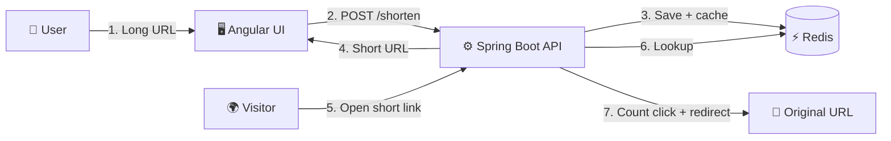

<div align="center">

# 🔗 MakeItShort

### Tiny links. Smart analytics. Blazing-fast redirects.

A full-stack **URL shortener** with custom aliases, link expiry, click analytics, rate limiting and **Redis-backed caching**.


</div>

---

## ✨ Features

| Icon | Feature | Description |
|:----:|---------|-------------|
| ✂️ | **Shorten URLs** | Turn any long link into a short, shareable one |
| 🏷️ | **Custom aliases** | Pick your own short code, or let the system generate one |
| ⏳ | **Link expiry** | Set an expiry date and time; expired links stop redirecting |
| 📊 | **Click analytics** | See how many times each short link was opened |
| 🚦 | **Rate limiting** | Counts requests per client/IP in a time window to stop abuse |
| ⚡ | **Redis caching** | Redirects are served from cache for very low latency |
| 🎨 | **Themeable UI** | Four built-in themes (Midnight, Snow, Lagoon, Sunset), all driven by CSS variables |

---

## 🧰 Tech Stack

| Layer | Technology |
|:-----:|------------|
| 🖥️ **Frontend** | Angular (reactive forms, signals), plain CSS design tokens |
| ⚙️ **Backend** | Java, Spring Boot, Spring Web |
| 🧠 **Cache** | Redis |
| 🛠️ **Build tools** | Maven or Gradle, npm |

---

## 🏗️ How It Works



---

## 📁 Project Structure

```text
MakeItShort/
├── 📂 backend/     ⚙️ Spring Boot REST API
├── 📂 frontend/    🖥️ Angular application
└── 📄 README.md
```


---

## 🚀 Getting Started

### ✅ Prerequisites

- ☕ Java 17 or newer
- 🟢 Node.js 18+ and npm
- 🧠 Redis running on `localhost:6379`
- 🅰️ Angular CLI (`npm install -g @angular/cli`)

### 1️⃣ Clone the repo

```bash
git clone https://github.com/iHamza7/MakeItShort.git
cd MakeItShort
```

### 2️⃣ Start Redis

```bash
redis-server
```

### 3️⃣ Run the backend ⚙️

```bash
cd backend
./mvnw spring-boot:run
```

The API starts on **http://localhost:8080**.

### 4️⃣ Run the frontend 🖥️

```bash
cd frontend
npm install
npm run start
```

Open **http://localhost:4200** in your browser. 🎉

---

## 🔌 API Overview

| Method | Endpoint | Purpose |
|:------:|----------|---------|
| `POST` | `/api/urls` | ✂️ Create a short URL (original URL, optional alias, optional expiry) |
| `GET`  | `/{shortCode}` | 🔀 Redirect to the original URL and count the click |
| `GET`  | `/api/urls/{shortCode}/stats` | 📊 Get original URL, clicks, active status and creator |


---

---

## 🎨 Customizing the UI

All colors, fonts, corner radius and spacing are CSS variables in the **design tokens** block at the top of the stylesheet. Change a value and the whole page follows. Each theme only overrides the tokens that differ, so adding a new theme takes just a few lines.

---

## 🗺️ Roadmap

- [x] ✂️ URL shortening with custom alias
- [x] ⏳ Link expiry
- [x] 📊 Click analytics
- [x] ⚡ Redis caching
- [x] 🚦 Rate limiting
- [ ] 📋 One-click copy button
- [ ] 📱 QR code for each short link
- [ ] 🔐 User accounts and a link dashboard
- [ ] 🐳 Docker Compose setup

---

## 🤝 Contributing

Contributions are welcome. 💙

1. 🍴 Fork the repo
2. 🌿 Create a branch: `git checkout -b feature/my-feature`
3. 💾 Commit: `git commit -m "Add my feature"`
4. 📤 Push: `git push origin feature/my-feature`
5. 🔃 Open a Pull Request

---

<div align="center">

### 👨‍💻 Built by [iHamza7](https://github.com/iHamza7)

⭐ If you like this project, give it a star!

</div>
